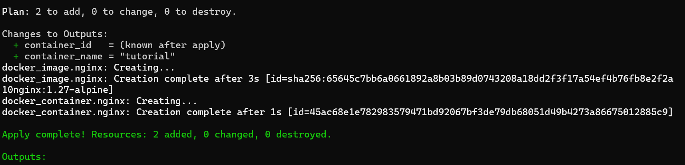
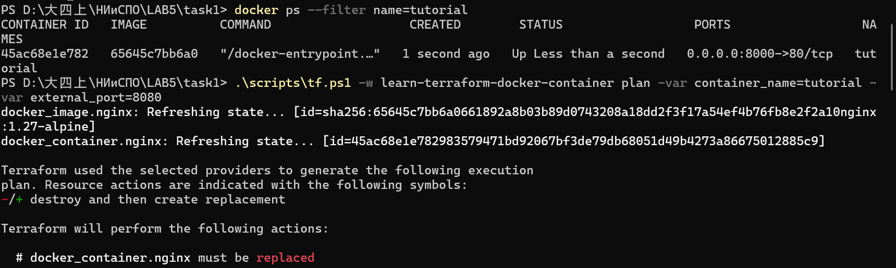
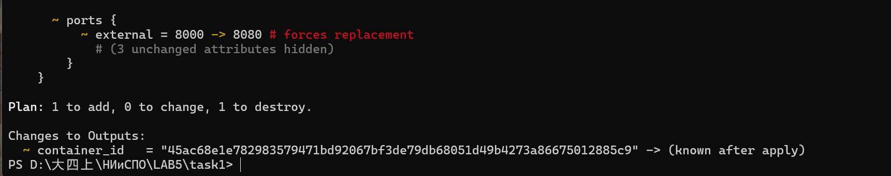
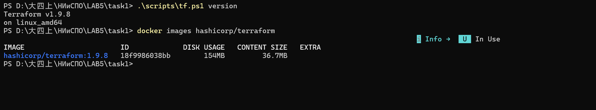
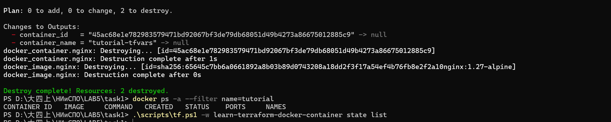

# Задание 1. Основы управления конфигурацией инфраструктуры с Terraform

Лабораторная работа №5, группа 13.
Выполнено первое задание: пройдены все **7 руководств** серии
[Get Started — Docker](https://developer.hashicorp.com/terraform/tutorials/docker-get-started)
официального руководства Terraform. Каждый шаг выполнен реально, вывод команд сохранён
в каталоге [`evidence/`](evidence/).

## Что требуется по заданию

> Изучить официальное руководство Terraform Tutorial и выполнить все 7 руководств
> в виртуальных лабораториях к каждому руководству. Продемонстрировать выполнение
> каждого из руководств и добавить в отчёт.

## Окружение и особенность его получения

| Компонент | Версия / значение |
|---|---|
| Terraform CLI | v1.9.8 (linux_amd64, официальный образ `hashicorp/terraform:1.9.8`) |
| Провайдер | `kreuzwerker/docker` v4.2.0 |
| Docker | 29.8.1 (Docker Desktop, Windows 11) |
| ОС хоста | Windows, команды запускаются из Git Bash |

**Важно.** Сайты `releases.hashicorp.com` и `registry.terraform.io` отдают из нашего
региона страницу «Content not available in your region», поэтому:

* CLI Terraform запускается из официального Docker-образа, а не ставится бинарником.
  Внутрь пробрасывается сокет `/var/run/docker.sock`, чтобы провайдер мог управлять
  контейнерами хоста. Обёртка — [`scripts/tf.sh`](scripts/tf.sh);
* провайдер `kreuzwerker/docker` скачивается из релизов GitHub
  ([`scripts/fetch-provider.sh`](scripts/fetch-provider.sh)) и подключается как
  **файловое зеркало** через [`terraform.tfrc`](terraform.tfrc):

```hcl
provider_installation {
  filesystem_mirror {
    path    = "/workspace/.plugins"
    include = ["registry.terraform.io/kreuzwerker/docker"]
  }
  direct {
    exclude = ["registry.terraform.io/kreuzwerker/docker"]
  }
}
```

Таким образом `terraform init` работает полностью офлайн, без обращения к реестру.
На результат самих руководств это не влияет: конфигурации, команды и вывод — штатные.

**Отличие от текста руководства.** В примерах используется образ `nginx:latest`,
мы используем `nginx:1.27-alpine`: на хосте уже есть контейнеры, созданные из `nginx:latest`
(`mynginxlast`) и `nginx:1.28` (`mynginx1-28`), из-за чего `terraform destroy` не может
удалить образ («conflict: unable to delete ... container is using its referenced image»).
Фиксированный тег, который никто не использует, делает `destroy` воспроизводимым.

## Структура каталога

```
task1/
├── terraform.tfrc                     # CLI-конфигурация: локальное зеркало провайдера
├── scripts/
│   ├── tf.sh                          # обёртка: docker run hashicorp/terraform (bash)
│   ├── tf.ps1                         # то же для Windows PowerShell
│   ├── fetch-provider.sh              # загрузка провайдера в .plugins/
│   └── demo.sh                        # сквозной прогон всех 7 руководств
├── learn-terraform-docker-container/  # рабочее пространство (как в руководстве)
│   ├── main.tf
│   ├── variables.tf
│   ├── outputs.tf
│   └── terraform.tfvars
├── tutorials/                         # снимки конфигурации после каждого шага
│   ├── 03-build/main.tf
│   ├── 04-change/main.tf
│   ├── 05-destroy/main.tf
│   ├── 06-variables/{main.tf,variables.tf,terraform.tfvars}
│   └── 07-outputs/{main.tf,variables.tf,outputs.tf,terraform.tfvars}
├── evidence/                          # вывод команд по шагам (01-iac.md … 08-cleanup.txt)
└── screenshots/                       # снимки экрана для отчёта
```

## Как воспроизвести

```bash
# 1. провайдер в локальное зеркало (один раз, ~21 МБ)
bash scripts/fetch-provider.sh 4.2.0

# 2. образ Terraform и образ nginx
docker pull hashicorp/terraform:1.9.8
docker pull nginx:1.27-alpine

# 3. проверить, что порты 8000, 8081, 8082, 8083, 8080 свободны

# 4. сквозной прогон: 7 руководств, вывод в evidence/
bash scripts/demo.sh
```

Отдельная команда выполняется так:

```bash
bash scripts/tf.sh -w learn-terraform-docker-container plan
bash scripts/tf.sh -w learn-terraform-docker-container apply
bash scripts/tf.sh -w learn-terraform-docker-container destroy
```

### Запуск из Windows PowerShell (без Git Bash)

Если Git Bash в системе не установлен, используется та же обёртка на PowerShell —
аргументы после `-w` передаются в Terraform без изменений:

```powershell
cd D:\大四上\НИиСПО\LAB5\task1
.\scripts\tf.ps1 version
.\scripts\tf.ps1 -w learn-terraform-docker-container plan
.\scripts\tf.ps1 -w learn-terraform-docker-container apply -var external_port=8000
.\scripts\tf.ps1 -w learn-terraform-docker-container destroy
```

Если запуск скриптов запрещён политикой (`PSSecurityException`, «在此系统上禁止运行脚本»),
достаточно один раз разрешить локальные скрипты для текущего пользователя — права
администратора не требуются:

```powershell
Set-ExecutionPolicy -Scope CurrentUser -ExecutionPolicy RemoteSigned
Get-ExecutionPolicy -List      # в строке CurrentUser должно быть RemoteSigned
```

Либо обойти политику разово, без изменения настроек:

```powershell
powershell -ExecutionPolicy Bypass -File .\scripts\tf.ps1 version
```

Переменные `TF_VAR_*` работают и в этом варианте:

```powershell
$env:TF_VAR_external_port = 8083
.\scripts\tf.ps1 -w learn-terraform-docker-container plan
```

---

## Шаг 1. What is Infrastructure as Code with Terraform?

Теоретическое руководство (видео + текст), команд не содержит. Конспект: что такое IaC,
зачем нужен, декларативная модель, цикл write → plan → apply, понятия провайдера, ресурса
и состояния — в файле [`evidence/01-iac.md`](evidence/01-iac.md).

## Шаг 2. Install Terraform

Проверка установки и quick start: создаём контейнер nginx и убеждаемся, что он отвечает.

```console
$ bash scripts/tf.sh version
Terraform v1.9.8
on linux_amd64

$ bash scripts/tf.sh -w learn-terraform-docker-container init
Initializing the backend...
Initializing provider plugins...
- Finding kreuzwerker/docker versions matching "~> 4.2.0"...
- Installing kreuzwerker/docker v4.2.0...
- Installed kreuzwerker/docker v4.2.0 (unauthenticated)
...
Terraform has been successfully initialized!

$ bash scripts/tf.sh -w learn-terraform-docker-container apply
...
Apply complete! Resources: 2 added, 0 changed, 0 destroyed.

$ curl -s http://localhost:8000/ | grep -o "<title>[^<]*</title>"
<title>Welcome to nginx!</title>

$ docker ps --filter name=tutorial
NAMES      IMAGE          STATUS          PORTS
tutorial   65645c7bb6a0   Up 15 seconds   0.0.0.0:8000->80/tcp
```

В конце шага ресурсы удалены (`destroy`), чтобы следующий шаг начинался с чистого состояния.
Полный вывод: [`evidence/02-install.txt`](evidence/02-install.txt).

## Шаг 3. Build infrastructure

Разбор конфигурации (`terraform {}`, `provider {}`, `resource`), форматирование, проверка
и применение. Конфигурация — [`tutorials/03-build/main.tf`](tutorials/03-build/main.tf).

```console
$ bash scripts/tf.sh -w learn-terraform-docker-container fmt
$ bash scripts/tf.sh -w learn-terraform-docker-container fmt -check
$ bash scripts/tf.sh -w learn-terraform-docker-container validate
Success! The configuration is valid.

$ bash scripts/tf.sh -w learn-terraform-docker-container plan
...
Plan: 2 to add, 0 to change, 0 to destroy.

$ bash scripts/tf.sh -w learn-terraform-docker-container apply
docker_image.nginx: Creating...
docker_image.nginx: Creation complete after 3s [id=sha256:65645c7bb6a0...nginx:1.27-alpine]
docker_container.nginx: Creating...
docker_container.nginx: Creation complete after 1s [id=87af507bda9a...]
Apply complete! Resources: 2 added, 0 changed, 0 destroyed.

$ bash scripts/tf.sh -w learn-terraform-docker-container state list
docker_container.nginx
docker_image.nginx

$ docker ps --filter name=tutorial
NAMES      IMAGE          STATUS          PORTS
tutorial   65645c7bb6a0   Up 15 seconds   0.0.0.0:8000->80/tcp

$ curl -s http://localhost:8000/ | grep -o "<title>[^<]*</title>"
<title>Welcome to nginx!</title>
```

Команда `terraform show` вывела полное содержимое состояния (атрибуты контейнера:
`ip_address`, `gateway`, `network_data`, блок `ports` и т. д.) — см.
[`evidence/03-build.txt`](evidence/03-build.txt). Именно эти значения Terraform
использует на следующих шагах.

## Шаг 4. Change infrastructure

Меняем внешний порт 8000 → 8080 и смотрим, как Terraform планирует изменение.

```console
$ sed -i "s/external = 8000/external = 8080/" main.tf
$ bash scripts/tf.sh -w learn-terraform-docker-container plan
  # docker_container.nginx must be replaced
      ~ external = 8000 -> 8080 # forces replacement

Plan: 1 to add, 0 to change, 1 to destroy.

$ bash scripts/tf.sh -w learn-terraform-docker-container apply
Apply complete! Resources: 1 added, 0 changed, 1 destroyed.

$ docker ps --filter name=tutorial
NAMES      IMAGE          STATUS         PORTS
tutorial   65645c7bb6a0   Up 2 seconds   0.0.0.0:8080->80/tcp

$ curl -s http://localhost:8080/ | grep -o "<title>[^<]*</title>"
<title>Welcome to nginx!</title>
```

Вывод: изменение опубликованного порта нельзя применить «на месте» — Terraform помечает
ресурс как `must be replaced`, то есть удаляет старый контейнер и создаёт новый.
Символы плана: `+` создать, `~` изменить на месте, `-/+` заменить.
Полный вывод: [`evidence/04-change.txt`](evidence/04-change.txt).

## Шаг 5. Destroy infrastructure

```console
$ bash scripts/tf.sh -w learn-terraform-docker-container destroy
...
Destroy complete! Resources: 2 destroyed.

$ docker ps -a --filter name=tutorial
NAMES     STATUS

$ bash scripts/tf.sh -w learn-terraform-docker-container state list
```

Состояние пустое, контейнеров и образа нет — инфраструктура удалена полностью.
Полный вывод: [`evidence/05-destroy.txt`](evidence/05-destroy.txt).

## Шаг 6. Define input variables

Имя контейнера и внешний порт выносим в переменные
([`tutorials/06-variables/variables.tf`](tutorials/06-variables/variables.tf)):

```hcl
variable "container_name" {
  description = "Имя Docker-контейнера"
  type        = string
  default     = "tutorial"
}

variable "external_port" {
  description = "Внешний порт, на который публикуется nginx"
  type        = number
  default     = 8000
}
```

Проверены все четыре способа задания значений:

**6.1. Значения по умолчанию**

```console
$ bash scripts/tf.sh -w learn-terraform-docker-container apply
Apply complete! Resources: 2 added, 0 changed, 0 destroyed.

$ docker ps --filter name=tutorial
tutorial   0.0.0.0:8000->80/tcp
```

**6.2. Флаги `-var`**

```console
$ bash scripts/tf.sh -w learn-terraform-docker-container apply \
    -var container_name=tutorial-var -var external_port=8082
      ~ name     = "tutorial" -> "tutorial-var" # forces replacement
      ~ external = 8000 -> 8082 # forces replacement
Apply complete! Resources: 1 added, 0 changed, 1 destroyed.

$ docker ps --filter name=tutorial
tutorial-var   0.0.0.0:8082->80/tcp
```

**6.3. Переменные окружения `TF_VAR_*`**

```console
$ TF_VAR_container_name=tutorial-env TF_VAR_external_port=8083 \
    bash scripts/tf.sh -w learn-terraform-docker-container apply
      ~ name     = "tutorial-var" -> "tutorial-env" # forces replacement
      ~ external = 8082 -> 8083 # forces replacement
Apply complete! Resources: 1 added, 0 changed, 1 destroyed.

$ docker ps --filter name=tutorial
tutorial-env   0.0.0.0:8083->80/tcp
```

**6.4. Файл `terraform.tfvars`** (подхватывается автоматически)

```console
$ cat terraform.tfvars
container_name = "tutorial-tfvars"
external_port  = 8081

$ bash scripts/tf.sh -w learn-terraform-docker-container plan
      ~ name     = "tutorial" -> "tutorial-tfvars" # forces replacement
      ~ external = 8000 -> 8081 # forces replacement
Plan: 1 to add, 0 to change, 1 to destroy.

$ bash scripts/tf.sh -w learn-terraform-docker-container apply
Apply complete! Resources: 1 added, 0 changed, 1 destroyed.

$ docker ps --filter name=tutorial
tutorial-tfvars   0.0.0.0:8081->80/tcp
```

Приоритет источников (от слабого к сильному): переменные окружения → `terraform.tfvars`
→ `*.auto.tfvars` → флаги `-var` / `-var-file`. Проверено на практике: при
существующем `terraform.tfvars` значение из `TF_VAR_*` перекрывается файлом.
Полный вывод: [`evidence/06-variables.txt`](evidence/06-variables.txt).

## Шаг 7. Query data with outputs

Объявляем выходные значения ([`tutorials/07-outputs/outputs.tf`](tutorials/07-outputs/outputs.tf)):

```hcl
output "container_name" {
  description = "Имя созданного контейнера"
  value       = docker_container.nginx.name
}

output "container_id" {
  description = "ID созданного контейнера"
  value       = docker_container.nginx.id
}
```

```console
$ bash scripts/tf.sh -w learn-terraform-docker-container apply
Apply complete! Resources: 0 added, 0 changed, 0 destroyed.

Outputs:

container_id   = "5278a666a1d15017485df7994db14eb759e76527a4188540fa0ebea973abf78e"
container_name = "tutorial-tfvars"

$ bash scripts/tf.sh -w learn-terraform-docker-container output
container_id   = "5278a666a1d1..."
container_name = "tutorial-tfvars"

$ bash scripts/tf.sh -w learn-terraform-docker-container output container_name
"tutorial-tfvars"

$ bash scripts/tf.sh -w learn-terraform-docker-container output -json
{
  "container_id": { "sensitive": false, "type": "string", "value": "5278a666a1d1..." },
  "container_name": { "sensitive": false, "type": "string", "value": "tutorial-tfvars" }
}

$ bash scripts/tf.sh -w learn-terraform-docker-container output -raw container_id \
    | xargs docker inspect --format '{{.Name}} -> {{.State.Status}}'
/tutorial-tfvars -> running
```

Последняя команда показывает практическую ценность outputs: значение из состояния
передаётся во внешний инструмент (`docker inspect`) и позволяет убедиться, что контейнер
с таким ID действительно работает.
Полный вывод: [`evidence/07-outputs.txt`](evidence/07-outputs.txt).

## Итоги

| № | Руководство | Что сделано | Подтверждение |
|---|-------------|-------------|---------------|
| 1 | What is Infrastructure as Code | конспект теории IaC, план/apply | `evidence/01-iac.md` |
| 2 | Install Terraform | `terraform version`, quick start, HTTP 200 на :8000 | `evidence/02-install.txt` |
| 3 | Build infrastructure | `init`/`fmt`/`validate`/`plan`/`apply`, `show`, `state list` | `evidence/03-build.txt` |
| 4 | Change infrastructure | план `-/+`, замена контейнера, порт 8000 → 8080 | `evidence/04-change.txt` |
| 5 | Destroy infrastructure | `destroy`, пустое состояние, нет контейнеров | `evidence/05-destroy.txt` |
| 6 | Define input variables | 4 способа: default, `-var`, `TF_VAR_*`, `terraform.tfvars` | `evidence/06-variables.txt` |
| 7 | Query data with outputs | `output`, `output -json`, `-raw` + `docker inspect` | `evidence/07-outputs.txt` |

После шага 7 выполнена финальная очистка ([`evidence/08-cleanup.txt`](evidence/08-cleanup.txt)):
`Destroy complete! Resources: 2 destroyed.`, контейнеров `tutorial*` не осталось.

## Скриншоты

Снимки экрана, подтверждающие выполнение руководств на своём компьютере
(подробная инструкция по съёмке — в [`screenshots/README.md`](screenshots/README.md)).

### Создание инфраструктуры (шаг 3) — `screenshots/build-apply.png`

`Plan: 2 to add` → создание образа и контейнера → `Apply complete! Resources:
2 added, 0 changed, 0 destroyed.`:



### Изменение инфраструктуры (шаг 4) — `screenshots/change-plan-1.png`, `change-plan-2.png`

Контейнер `tutorial` работает на порту 8000, Terraform планирует смену порта
на 8080 и помечает ресурс `must be replaced`; строка
`~ external = 8000 -> 8080 # forces replacement` и план
`1 to add, 0 to change, 1 to destroy` доказывают, что порт нельзя поменять
без пересоздания контейнера:





### Установка CLI (шаг 2) — `screenshots/terraform-version.png`

`Terraform v1.9.8` из официального образа и сам образ в локальном реестре Docker:



### Удаление инфраструктуры (шаг 5) — `screenshots/destroy.png`

`Destroy complete! Resources: 2 destroyed.`, таблица `docker ps -a` пуста —
инфраструктура удалена полностью:



Необязательные снимки `outputs.png` (шаг 7) и `variables.png` (шаг 6) не делались —
полный вывод этих шагов зафиксирован в [`evidence/06-variables.txt`](evidence/06-variables.txt)
и [`evidence/07-outputs.txt`](evidence/07-outputs.txt).


## Автор

Цзэн Яосинь (ZENG YAOXIN), студент группы 13, ФПМИ БГУ.
