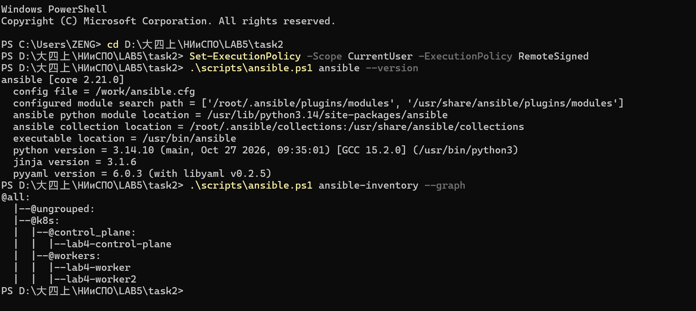
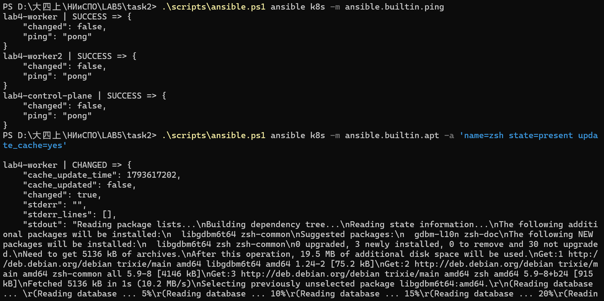
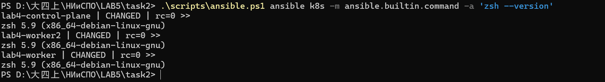
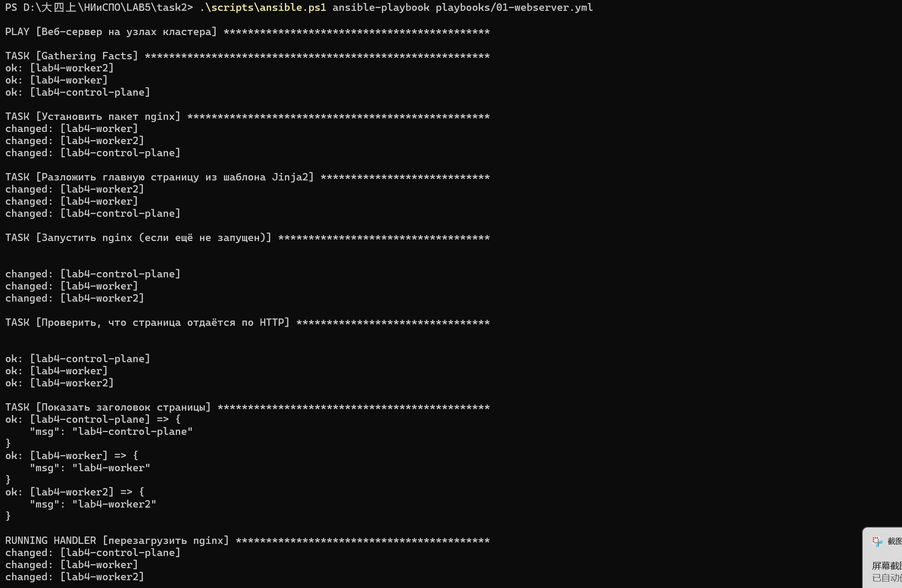
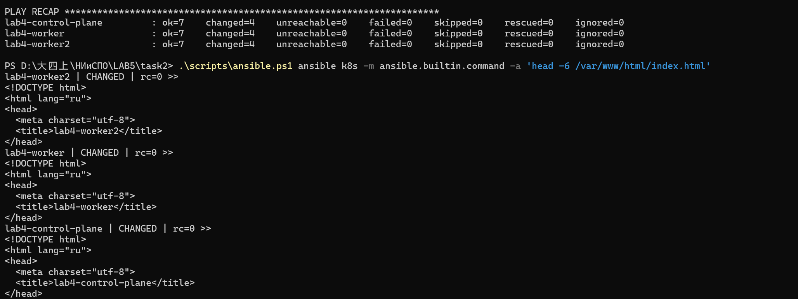
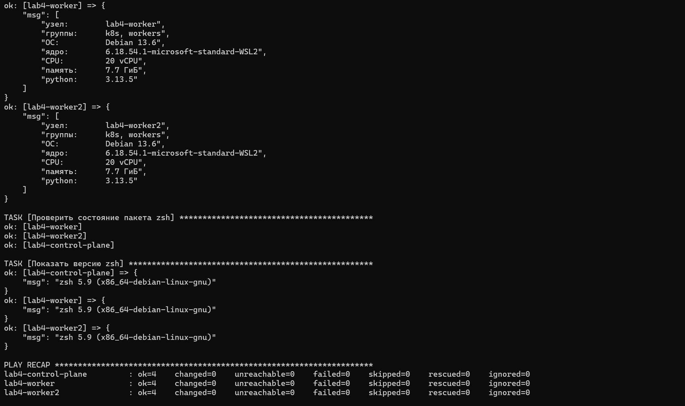

# Задание 2. Управление конфигурацией серверов с помощью Ansible

Лабораторная работа №5, группа 13.
Выполнено второе задание: изучены материалы по инвентарям, ad-hoc командам,
CLI-инструментам и playbook, продемонстрировано подключение к узлам кластера
Kubernetes и установка пакетов, написаны и выполнены playbook. Вывод каждой
команды сохранён в каталоге [`evidence/`](evidence/) — это и есть «результаты
тестирования» для отчёта.

## Что требуется по заданию

> **Задание 2. Управление конфигурацией серверов с помощью Ansible**
> 1. Изучить статьи *How To Set Up Ansible Inventories* и *How To Manage Multiple
>    Servers with Ansible Ad Hoc Commands*.
> 2. Изучить документацию *Using Ansible command line tools*.
> 3. Продемонстрировать подключение к виртуальным машинам, созданным для кластера
>    Kubernetes в лабораторной работе 3, и установку любого пакета, например `zsh`,
>    с помощью команд.
> 4. Изучить статью *How To Write Ansible Playbooks* и документацию
>    *Using Ansible playbooks*.
> 5. Настроить конфигурации в виде файлов playbook на основе примеров из статьи
>    в п. 4 и продемонстрировать их.
> 6. Выполнить примеры из руководства Ansible (Playbook) и продемонстрировать
>    результаты.
> 7. Опубликовать конфигурационные файлы в репозиторий.

**Уточнение к п. 3.** В тексте методички указана «лабораторная работа 3», однако
кластер Kubernetes на самом деле создавался в **лабораторной работе №4** (утилита
`kind`), поэтому здесь используются его узлы — `lab4-control-plane`, `lab4-worker`,
`lab4-worker2`. Это те же самые «виртуальные машины кластера», только реализованные
методом Docker-in-Docker: каждый узел — отдельный контейнер.

## Окружение и особенность его получения

| Компонент | Версия / значение |
|---|---|
| Ansible | `ansible [core 2.21.0]` (Python 3.14.10 внутри образа) |
| Образ управляющего узла | `alpine/ansible:latest` + `docker-cli`, собран как `lab5-ansible:1.0` |
| Плагин подключения | `community.docker.docker` (команды через `docker exec`) |
| Целевые узлы | 3 контейнера `kindest/node:v1.37.0` кластера `lab4` (Debian 13 trixie) |
| Python на узлах | 3.13.5 (устанавливается playbook `00-bootstrap.yml`) |
| Docker / хост | 29.8.1, Windows 11 (Docker Desktop) |

Задание предполагает «обычный» Linux-стенд с SSH, но на этом компьютере возникли
три особенности, и каждая решена в конфигурационных файлах:

1. **Управляющий узел — контейнер, а не хост.** Ansible не поддерживает Windows как
   control node, а WSL в системе отключён политикой безопасности. Поэтому `ansible`,
   `ansible-playbook`, `ansible-inventory` запускаются внутри образа
   [`Dockerfile`](Dockerfile), которому проброшен сокет `/var/run/docker.sock`.
   Обёртки — [`scripts/ansible.sh`](scripts/ansible.sh) (Git Bash) и
   [`scripts/ansible.ps1`](scripts/ansible.ps1) (Windows PowerShell).

2. **Узлы kind — контейнеры без SSH.** В них нет sshd, поэтому вместо стандартного
   `ssh` используется подключаемый модуль `community.docker.docker`: он выполняет
   команды внутри контейнера через `docker exec`. Это задано переменной
   `ansible_connection` в [`inventory/hosts.yml`](inventory/hosts.yml). Инвентарь
   при этом самый обычный — YAML с группами `k8s → control_plane / workers`, как
   и в статье *How To Set Up Ansible Inventories*.

3. **Минимальный образ kind не содержит python3**, а все модули Ansible (кроме
   `raw`) выполняются на целевом узле на Python. Поэтому первый playbook
   [`00-bootstrap.yml`](playbooks/00-bootstrap.yml) ставит python3 модулем `raw`
   (он работает без интерпретатора). Дополнительно: в узлах прописан прокси
   `127.0.0.1:54031`, недоступный изнутри контейнера, поэтому playbook отключает
   его для `apt` (файл `/etc/apt/apt.conf.d/99-noproxy`), а задачи с пакетами
   очищают переменные окружения прокси через `environment: "{{ clear_proxy }}"`.

> Ещё одна адаптация к контейнерам: `systemd` в узлах kind не управляет службами,
> поэтому nginx в [`01-webserver.yml`](playbooks/01-webserver.yml) запускается
> модулем `command` (с `creates:` для идемпотентности), а обработчик перечитывает
> конфигурацию командой `nginx -s reload` вместо `service: restarted`.

На саму логику задания это не влияет: инвентарь, ad-hoc команды и playbook — штатные,
меняется только способ подключения к целевым машинам.

## Структура каталога

```
task2/
├── Dockerfile                         # образ управляющего узла lab5-ansible:1.0
├── ansible.cfg                        # inventory, interpreter_python, вывод без цвета
├── inventory/
│   └── hosts.yml                      # группы k8s / control_plane / workers
├── playbooks/
│   ├── 00-bootstrap.yml               # подготовка: python3 + настройка apt
│   ├── 01-webserver.yml               # основной playbook: apt + Jinja2 + handler
│   ├── 02-facts.yml                   # сбор фактов об узлах
│   └── 03-official-example.yml        # «My first play» из официальной документации Ansible
├── templates/
│   └── index.html.j2                   # страница с данными из фактов узла
├── scripts/
│   ├── ansible.sh                     # обёртка docker run (Git Bash)
│   ├── ansible.ps1                    # то же для Windows PowerShell
│   └── demo.sh                        # сквозной прогон всех 9 шагов в evidence/
├── evidence/                          # сохранённый вывод каждой команды (01…09)
└── screenshots/                       # снимки экрана для отчёта (инструкция внутри)
```

## Роль компонентов

| Файл | Что делает | Пункт задания |
|---|---|---|
| [`inventory/hosts.yml`](inventory/hosts.yml) | описывает 3 узла и группы, задаёт плагин `community.docker.docker` и `ansible_user: root` | 1, 3 |
| [`ansible.cfg`](ansible.cfg) | путь к инвентарю, `interpreter_python`, отключение проверки ключей и цвета | 2 |
| [`Dockerfile`](Dockerfile) | контрольный узел: `alpine/ansible` + `docker-cli` (нужен плагину подключения) | — |
| [`scripts/ansible.sh`](scripts/ansible.sh) / [`.ps1`](scripts/ansible.ps1) | запуск любой команды Ansible в контейнере с проброшенным сокетом Docker | 2 |
| [`playbooks/00-bootstrap.yml`](playbooks/00-bootstrap.yml) | `raw` → установка python3, настройка `apt` без прокси, проверка через `setup` | 3 (подготовка) |
| [`playbooks/01-webserver.yml`](playbooks/01-webserver.yml) | `apt` (nginx) + `template` + `command` + `uri` + `handler` — пример из *How To Write Ansible Playbooks* | 4, 5 |
| [`templates/index.html.j2`](templates/index.html.j2) | Jinja2-шаблон с `inventory_hostname`, группой, ОС, ядром, версией Python | 5 |
| [`playbooks/02-facts.yml`](playbooks/02-facts.yml) | `gather_facts` и вывод характеристик узлов, `--limit` для выборки | 2, 4 |
| [`playbooks/03-official-example.yml`](playbooks/03-official-example.yml) | «My first play»: `ping` + `debug` из раздела *Creating a playbook* | 6 |
| [`scripts/demo.sh`](scripts/demo.sh) | воспроизводит все 9 шагов и пишет `evidence/NN-*.txt` | 7 |
| [`evidence/`](evidence/) | реальный вывод команд (результаты тестирования) | 3, 5, 6, 7 |

## Как воспроизвести

### Предварительные условия

1. Запущен Docker Desktop и кластер `kind` из лабораторной работы №4
   (три контейнера `lab4-control-plane`, `lab4-worker`, `lab4-worker2`):

   ```powershell
   docker ps --filter name=lab4
   ```

2. Собран образ управляющего узла (один раз):

   ```powershell
   cd D:\大四上\НИиСПО\LAB5\task2
   docker build -t lab5-ansible:1.0 .
   ```

### Сквозной прогон (все 9 шагов сразу)

```bash
bash scripts/demo.sh          # Git Bash: E:\GIT\Git\bin\bash.exe
```

Скрипт последовательно выполняет все команды и перезаписывает `evidence/NN-*.txt`,
а в конце **приводит стенд в исходное состояние** (удаляет тестовые `zsh`, `nginx`
и страницу), поэтому прогон можно повторять.

> **Идемпотентность.** Файлы `evidence/` зафиксированы при первом прогоне на
> «чистых» узлах (без python3, zsh, nginx): поэтому в `03-bootstrap.txt` установка
> python3 помечена `changed`, а в `07-idempotency.txt` повторный запуск того же
> playbook даёт `changed=0`. При повторном запуске `demo.sh` часть задач покажет
> `ok`/`skipped` вместо `changed` — это штатное поведение Ansible, а не ошибка.

### Отдельные команды (Git Bash)

```bash
bash scripts/ansible.sh ansible-inventory --graph
bash scripts/ansible.sh ansible k8s -m ansible.builtin.ping
bash scripts/ansible.sh ansible k8s -m ansible.builtin.apt -a 'name=zsh state=present'
bash scripts/ansible.sh ansible-playbook playbooks/01-webserver.yml
```

### Запуск из Windows PowerShell (без Git Bash)

Если Git Bash не установлен, используется та же обёртка на PowerShell — аргументы
передаются в Ansible без изменений (скрипт использует `$args`, поэтому флаги
`-m`, `-a`, `--limit` не перехватываются):

```powershell
cd D:\大四上\НИиСПО\LAB5\task2
.\scripts\ansible.ps1 ansible-inventory --graph
.\scripts\ansible.ps1 ansible k8s -m ansible.builtin.ping
.\scripts\ansible.ps1 ansible k8s -m ansible.builtin.apt -a 'name=zsh state=present'
.\scripts\ansible.ps1 ansible-playbook playbooks/01-webserver.yml
```

Если запуск скриптов запрещён политикой (`PSSecurityException`,
«在此系统上禁止运行脚本»), достаточно один раз разрешить локальные скрипты для
текущего пользователя — права администратора не требуются:

```powershell
Set-ExecutionPolicy -Scope CurrentUser -ExecutionPolicy RemoteSigned
Get-ExecutionPolicy -List      # в строке CurrentUser должно быть RemoteSigned
```

Либо обойти политику разово:

```powershell
powershell -ExecutionPolicy Bypass -File .\scripts\ansible.ps1 ansible k8s -m ansible.builtin.ping
```

---

## Шаг 1. Инвентарь и версия Ansible

```console
$ scripts/ansible.sh ansible --version
ansible [core 2.21.0]
  config file = /work/ansible.cfg
  ...
  python version = 3.14.10 ...

$ scripts/ansible.sh ansible-inventory --graph

@all:
  |--@ungrouped:
  |--@k8s:
  |  |--@control_plane:
  |  |  |--lab4-control-plane
  |  |--@workers:
  |  |  |--lab4-worker
  |  |  |--lab4-worker2
```

Граф подтверждает вложенные группы из `hosts.yml`. Полный вывод:
[`evidence/01-inventory.txt`](evidence/01-inventory.txt).

## Шаг 2. Ad-hoc: подключение к узлам (модуль raw)

До установки python3 на узлах работают только «сырые» команды. Модуль `raw`
не требует интерпретатора на целевой машине:

```console
$ scripts/ansible.sh ansible k8s -m ansible.builtin.raw -a 'hostname; . /etc/os-release; echo $PRETTY_NAME'

lab4-control-plane | CHANGED | rc=0 >>
lab4-control-plane
Debian GNU/Linux 13 (trixie)

lab4-worker | CHANGED | rc=0 >>
lab4-worker
Debian GNU/Linux 13 (trixie)

lab4-worker2 | CHANGED | rc=0 >>
lab4-worker2
Debian GNU/Linux 13 (trixie)
```

Это и есть демонстрация подключения к «виртуальным машинам» кластера (п. 3 задания).
Полный вывод: [`evidence/02-adhoc-connect.txt`](evidence/02-adhoc-connect.txt).

## Шаг 3. Подготовка узлов: playbook `00-bootstrap.yml`

```console
$ scripts/ansible.sh ansible-playbook playbooks/00-bootstrap.yml

TASK [Установить python3 (apt, переменные прокси очищены)] ***
changed: [lab4-worker]
changed: [lab4-control-plane]
changed: [lab4-worker2]

TASK [Показать версию python3] ***
ok: [lab4-control-plane] => {
    "msg": "python3: Python 3.13.5 (было: absent)"
}
...
PLAY RECAP ***
lab4-control-plane : ok=7  changed=2  unreachable=0  failed=0 ...
lab4-worker        : ok=7  changed=2  unreachable=0  failed=0 ...
lab4-worker2       : ok=7  changed=2  unreachable=0  failed=0 ...
```

После этого на узлах доступны обычные модули (`setup`, `apt`, `template`, …).
Полный вывод: [`evidence/03-bootstrap.txt`](evidence/03-bootstrap.txt).

## Шаг 4. Ad-hoc: ping и установка пакета zsh

```console
$ scripts/ansible.sh ansible k8s -m ansible.builtin.ping
lab4-control-plane | SUCCESS => { "ping": "pong" }
lab4-worker        | SUCCESS => { "ping": "pong" }
lab4-worker2       | SUCCESS => { "ping": "pong" }

$ scripts/ansible.sh ansible k8s -m ansible.builtin.apt -a 'name=zsh state=present update_cache=yes'
lab4-worker2       | CHANGED => { ... "The following NEW packages will be installed:\n  libgdbm6t64 zsh zsh-common" ... }
lab4-control-plane | CHANGED => { ... }
lab4-worker        | CHANGED => { ... }

$ scripts/ansible.sh ansible k8s -m ansible.builtin.command -a 'zsh --version'
lab4-control-plane | CHANGED | rc=0 >>
zsh 5.9 (x86_64-debian-linux-gnu)
lab4-worker        | CHANGED | rc=0 >>
zsh 5.9 (x86_64-debian-linux-gnu)
lab4-worker2       | CHANGED | rc=0 >>
zsh 5.9 (x86_64-debian-linux-gnu)
```

Пакет `zsh` из п. 3 задания установлен одной ad-hoc командой на все три узла,
результат проверен второй командой. Полный вывод:
[`evidence/04-adhoc-zsh.txt`](evidence/04-adhoc-zsh.txt).

## Шаг 5. Playbooks: факты, веб-сервер, идемпотентность

### 5.1. Факты об узлах (`02-facts.yml`) и ограничение выборки `--limit`

```console
$ scripts/ansible.sh ansible-playbook playbooks/02-facts.yml

TASK [Основные характеристики узла] ***
ok: [lab4-control-plane] => {
    "msg": [
        "узел:        lab4-control-plane",
        "группы:      control_plane, k8s",
        "ОС:          Debian 13.6",
        "ядро:        6.18.54.1-microsoft-standard-WSL2",
        "CPU:         20 vCPU",
        "память:      7.7 ГиБ",
        "python:      3.13.5"
    ]
}
...

$ scripts/ansible.sh ansible k8s --limit lab4-worker -m ansible.builtin.command -a uptime
lab4-worker | CHANGED | rc=0 >>
 11:08:21 up  7:14,  0 users,  load average: 2.08, 1.31, 1.21
```

Полный вывод: [`evidence/05-facts.txt`](evidence/05-facts.txt).

### 5.2. Основной playbook (`01-webserver.yml`)

Пример из статьи *How To Write Ansible Playbooks*: установить пакет, разложить
конфигурацию по шаблону, перезапустить службу через обработчик. Шаблон
[`templates/index.html.j2`](templates/index.html.j2) подставляет в `<title>` имя узла.

```console
$ scripts/ansible.sh ansible-playbook playbooks/01-webserver.yml --syntax-check
playbook: playbooks/01-webserver.yml

$ scripts/ansible.sh ansible-playbook playbooks/01-webserver.yml

TASK [Установить пакет nginx] ***                       changed: [все 3 узла]
TASK [Разложить главную страницу из шаблона Jinja2] *** changed: [все 3 узла]
TASK [Запустить nginx (если ещё не запущен)] ***         changed: [все 3 узла]
TASK [Проверить, что страница отдаётся по HTTP] ***     ok: [все 3 узла]
TASK [Показать заголовок страницы] ***
ok: [lab4-control-plane] => { "msg": "lab4-control-plane" }
ok: [lab4-worker]        => { "msg": "lab4-worker" }
ok: [lab4-worker2]       => { "msg": "lab4-worker2" }

RUNNING HANDLER [перезагрузить nginx] ***                changed: [все 3 узла]

PLAY RECAP ***
lab4-control-plane : ok=7  changed=4  unreachable=0  failed=0 ...
lab4-worker        : ok=7  changed=4  unreachable=0  failed=0 ...
lab4-worker2       : ok=7  changed=4  unreachable=0  failed=0 ...

$ scripts/ansible.sh ansible k8s -m ansible.builtin.command -a 'head -6 /var/www/html/index.html'
lab4-worker2 | CHANGED | rc=0 >>
<!DOCTYPE html>
<html lang="ru">
<head>
  <meta charset="utf-8">
  <title>lab4-worker2</title>
</head>
...
```

Обработчик (`notify`) сработал один раз в конце пьесы, хотя изменений было два;
модуль `uri` подтвердил HTTP 200 на каждом узле. Полный вывод:
[`evidence/06-playbook.txt`](evidence/06-playbook.txt).

### 5.3. Идемпотентность (повторный запуск)

```console
$ scripts/ansible.sh ansible-playbook playbooks/01-webserver.yml

TASK [Установить пакет nginx] ***                        ok: [все 3 узла]
TASK [Разложить главную страницу из шаблона Jinja2] ***   ok: [все 3 узла]
TASK [Запустить nginx (если ещё не запущен)] ***          ok: [все 3 узла]
...
PLAY RECAP ***
lab4-control-plane : ok=6  changed=0  unreachable=0  failed=0 ...
lab4-worker        : ok=6  changed=0  unreachable=0  failed=0 ...
lab4-worker2       : ok=6  changed=0  unreachable=0  failed=0 ...
```

Тот же playbook во второй раз **ничего не меняет** (`changed=0`), обработчик не
вызывается — ключевое свойство Ansible. Полный вывод:
[`evidence/07-idempotency.txt`](evidence/07-idempotency.txt).

## Шаг 6. Примеры из официального руководства и CLI-инструменты (п. 2, 6)

[`03-official-example.yml`](playbooks/03-official-example.yml) — «My first play» из
раздела *Creating a playbook* документации Ansible: два задания `ping` и `debug`.

```console
$ scripts/ansible.sh ansible-playbook playbooks/03-official-example.yml

TASK [Ping my hosts] ***
ok: [lab4-worker]
ok: [lab4-worker2]
ok: [lab4-control-plane]

TASK [Print message] ***
ok: [lab4-control-plane] => { "msg": "Hello world" }
ok: [lab4-worker]        => { "msg": "Hello world" }
ok: [lab4-worker2]       => { "msg": "Hello world" }

PLAY RECAP ***
lab4-control-plane : ok=3  changed=0  unreachable=0  failed=0 ...
lab4-worker        : ok=3  changed=0  unreachable=0  failed=0 ...
lab4-worker2       : ok=3  changed=0  unreachable=0  failed=0 ...
```

CLI-инструменты из п. 2 задания — `--syntax-check`, `--list-hosts`, `--list-tasks`:

```console
$ scripts/ansible.sh ansible-playbook playbooks/01-webserver.yml --list-hosts
  play #1 (k8s): Веб-сервер на узлах кластера	TAGS: []
    pattern: ['k8s']
    hosts (3):
      lab4-worker2
      lab4-worker
      lab4-control-plane

$ scripts/ansible.sh ansible-playbook playbooks/01-webserver.yml --list-tasks
    tasks:
      Установить пакет nginx	TAGS: []
      Разложить главную страницу из шаблона Jinja2	TAGS: []
      Запустить nginx (если ещё не запущен)	TAGS: []
      Проверить, что страница отдаётся по HTTP	TAGS: []
      Показать заголовок страницы	TAGS: []
```

В конце прогона стенд приводится в исходное состояние (`zsh`, `nginx`, страница
удалены), что проверяется модулем `raw`:

```console
python3=Python 3.13.5 zsh=absent nginx-bin=absent index.html=absent   # на всех 3 узлах
```

Полный вывод: [`evidence/08-official-example.txt`](evidence/08-official-example.txt)
и [`evidence/09-cli-and-cleanup.txt`](evidence/09-cli-and-cleanup.txt).

## Итоги

| № | Пункт задания | Что сделано | Подтверждение |
|---|---|---|---|
| 1 | Инвентари, ad-hoc статьи | YAML-инвентарь с вложенными группами, `ansible-inventory --graph` | `hosts.yml`, `evidence/01` |
| 2 | Using Ansible command line tools | `--version`, `--graph`, `--list-hosts`, `--list-tasks`, `--syntax-check`, `--limit` | `evidence/01`, `05`, `09` |
| 3 | Подключение к ВМ кластера + установка пакета | `raw`-подключение к 3 узлам, `apt name=zsh`, проверка `zsh --version` | `evidence/02`, `04` |
| 4 | How To Write Ansible Playbooks | playbook с заданиями, переменными, `notify`/handler, шаблоном | `01-webserver.yml` |
| 5 | Конфигурации в виде playbook + демонстрация | nginx + Jinja2 + `uri`, повторный запуск `changed=0` | `evidence/06`, `07` |
| 6 | Примеры из руководства Ansible | «My first play» (`ping` + `debug`) | `evidence/08` |
| 7 | Публикация конфигурационных файлов | весь каталог `task2/` в репозитории | этот README |

## Скриншоты

Снимки экрана, подтверждающие выполнение на своём компьютере (подробная
инструкция по съёмке — в [`screenshots/README.md`](screenshots/README.md)).

### Инвентарь и версия Ansible — `screenshots/ansible-inventory.png`

`ansible [core 2.21.0]`, конфиг `/work/ansible.cfg` и граф вложенных групп
с тремя узлами кластера:



### Подключение к узлам и установка пакета (п. 3 задания) — `screenshots/adhoc-ping-zsh.png`, `adhoc-zsh-version.png`

Три `"ping": "pong"`, установка `zsh` одной ad-hoc командой на все узлы
(`CHANGED`) и проверка версии — доказательство подключения к «виртуальным
машинам» кластера:





### Основной playbook (п. 5 задания) — `screenshots/playbook-webserver-1.png`, `playbook-webserver-2.png`

Первый запуск: установка nginx, страница из шаблона Jinja2, запуск через
`command`, проверка HTTP и обработчик в конце пьесы; в `PLAY RECAP` —
`changed=4` на каждом узле; проверка `head -6` показывает три разные страницы
с именем узла в `<title>`:





### Факты об узлах — `screenshots/facts.png`

`02-facts.yml`: ОС, ядро, CPU, память, версия Python и установленного `zsh`
на каждом узле:



Необязательный снимок `official-example.png` («My first play», п. 6 задания)
не делался — вывод команды зафиксирован в
[`evidence/08-official-example.txt`](evidence/08-official-example.txt).

## Автор

Цзэн Яосинь (ZENG YAOXIN), студент группы 13, ФПМИ БГУ.
